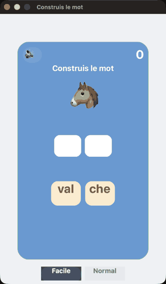

# BuildWord

**"Construis le mot" — a syllable game for kids.** A picture, empty slots, and shuffled syllable
tiles; tap the syllables **in order** to spell the word. Built on
[Hero](https://github.com/mesopelagique/Hero) (`cs.hero`).

## Play

Open the project — `On Startup` launches it. Tap the tiles in order: the next correct syllable
flies into its slot, a wrong tile shakes and beeps. Complete the word to win and move on.
**Facile** uses two-syllable words, **Normal** up to four.

## `cs.BuildWord`

| Function | Action |
|:-|:-|
| `.newQuestion()` | Pick a word, lay out empty slots and shuffled syllable tiles. |
| `.tapTile($i)` | Place tile `$i` if it is the next syllable, else shake it. |
| `.selectLevel($i)` | `1` = Facile (2 syllables), else Normal. |
